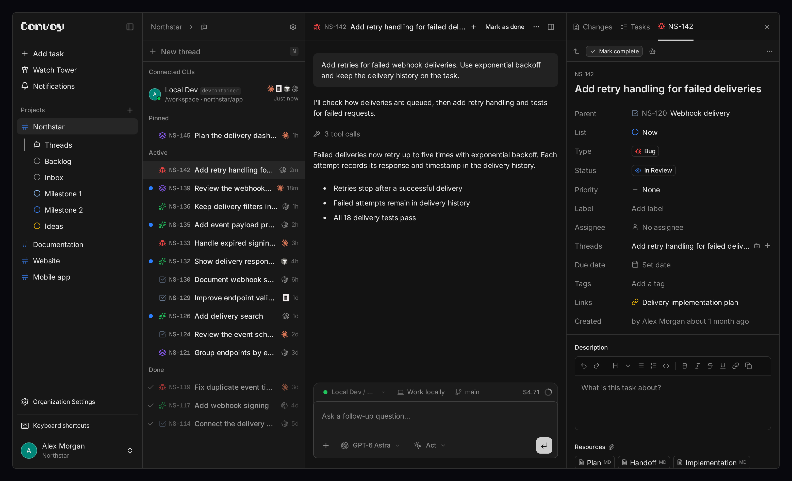
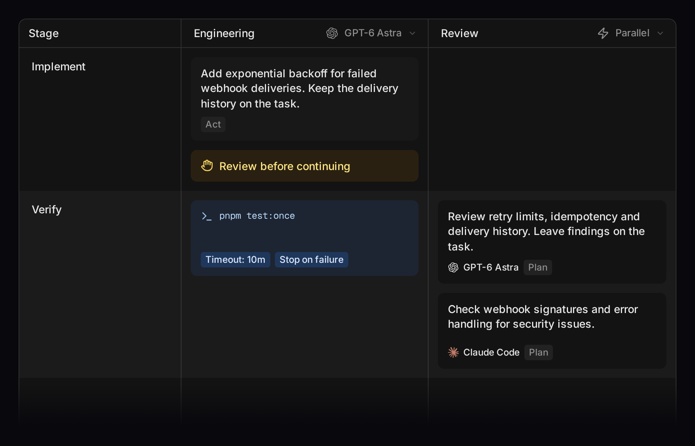
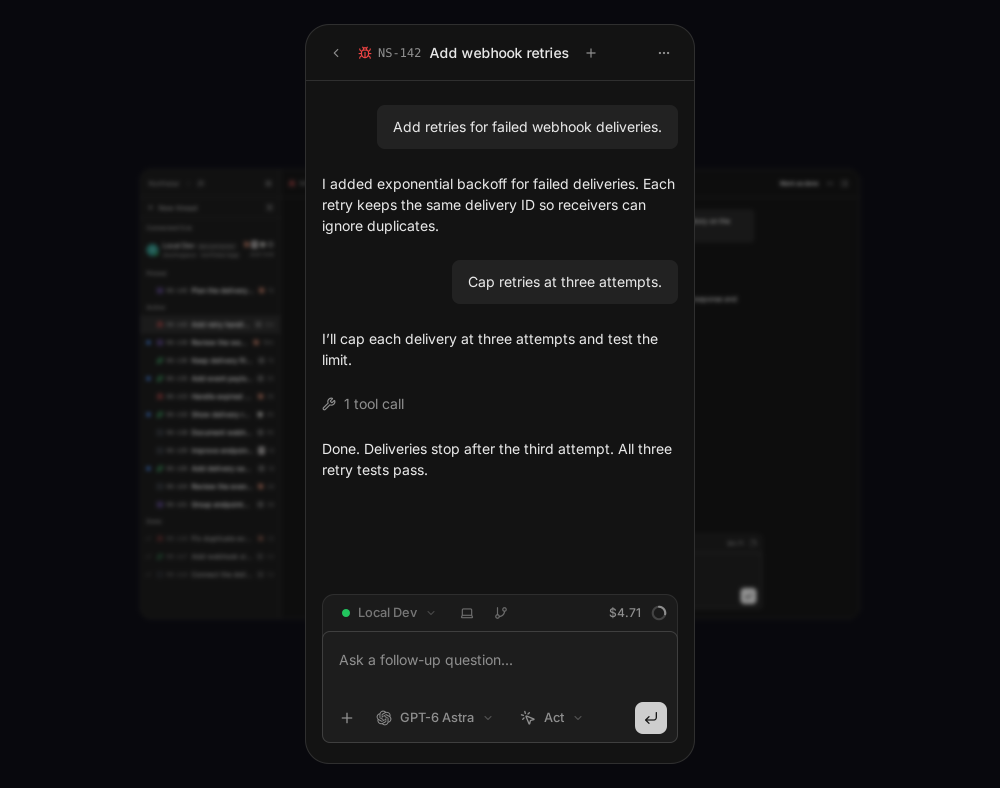
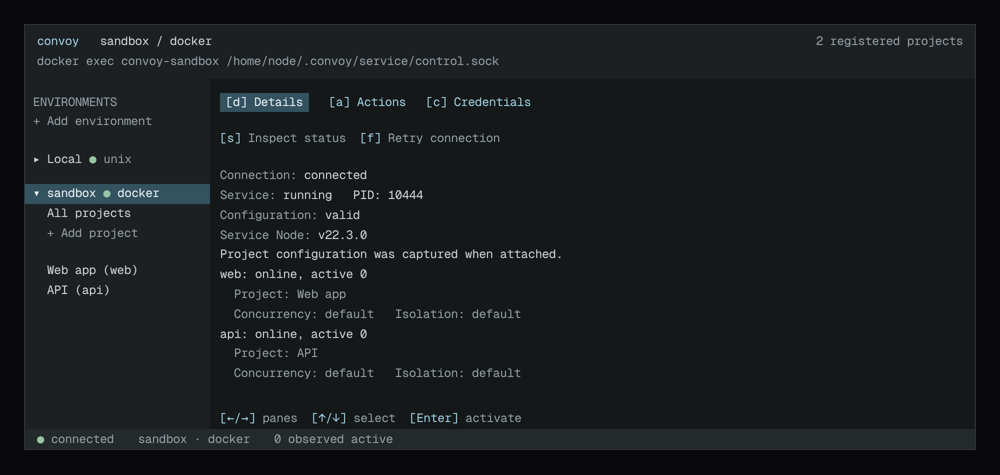
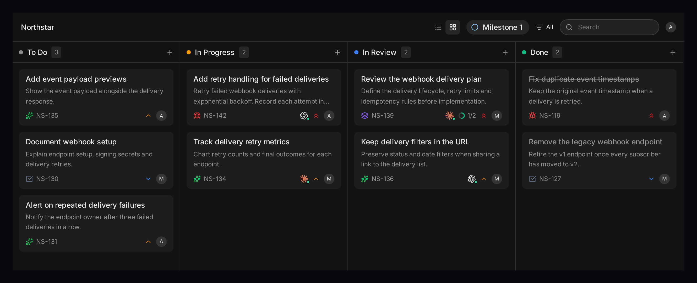
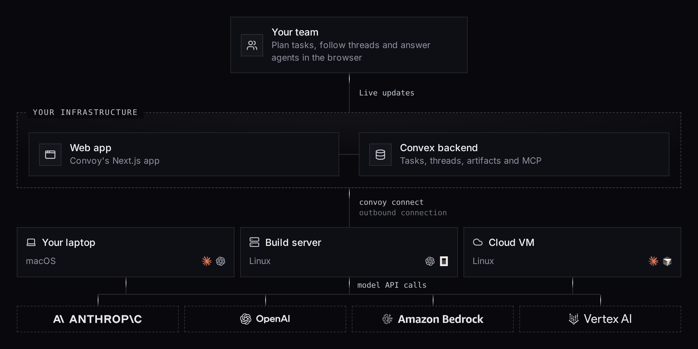

# Convoy

Convoy is a project management app for teams working with AI coding agents.
Manage tasks, run Claude Code, Codex, OpenCode or Cursor against your repos,
and review their output in the browser. Agents run on your machines; the web
app shows their conversations, tool calls and code changes.



Open **project → Actions → Runtime access** to check accounts or change access
after setup. The same screen during project setup shows native login status from the project's
private environment. Each runtime has separate authentication and account-status rows. Sign-in actions
are grouped below the status;
Refresh checks the account again. Account checks require CLI 0.123.0 and the
updated project launcher in the execution environment. Shared project notices
group runtime warnings; press **w** to read complete diagnostics and recovery steps.

## Run it

Install Docker with Compose, then:

```bash
git clone https://github.com/packtrain/convoy.git
cd convoy
./self-hosted/start.sh
```

Open [localhost:3000](http://127.0.0.1:3000) when setup finishes.

The script starts the web app and Convex backend. Choose **local demo** to try
it without an account, or **Clerk** for multi-user authentication. Demo mode
has no authentication. Keep it on localhost and don't use it for sensitive data.

See the [self-hosting guide](self-hosted/README.md) for configuration and upgrades.

### Connect an agent

On the machine with your repos, install and authenticate a supported coding
agent, then install the Convoy CLI with npm:

```bash
npm install -g @useconvoy/cli
convoy
```

Follow the setup wizard to connect your deployment, project and local repo.
Keep the CLI running, open a thread in the web app, select your connected
profile and agent, and send a message. Run `convoy connect` to reconnect later.

See [CLI setup](https://docs.convoy.build/docs/cli/setup-and-connect) for details.

Convoy is developed and tested on macOS. Linux and Windows should work but get
less testing. If something breaks on your platform, issues and pull requests are
welcome.

## Features and roadmap

| Feature | What it does | Status |
| --- | --- | --- |
| GitHub integration for PRs | Connect GitHub repositories and read their pull requests in Convoy: commits, checks, merge status, stacks, referenced tasks, and diffs with Reviewed marks. PR links in tasks and threads open the reader. Comments with attached files, reviews with inline comments, reviewer requests, state changes, and merging run as each member's GitHub account. | In progress |
| PR guided reviews | Review pull requests with a guided review flow. | In progress |
| Remove environments | Remove configured environments. | Next |
| Recurring tasks | Create tasks on a repeating schedule. | Next |
| Task templates | Create tasks from reusable templates. | Next |
| Skills, prompts and workflows packs | Bundle reusable skills, prompts and workflows. | Next |
| Mobile app | Access Convoy from a dedicated mobile app. | Next |
| Kanban and task lists | Track tasks with custom statuses, labels, priorities and sections. | Available |
| Claude Code, Codex, OpenCode and Cursor | Run agents against your repos and follow output in browser threads. | Available |
| Diff review | Inspect code changes and leave inline comments. | Available |
| Usage and cost tracking | See reported usage and estimated costs per thread. | Available |
| Task assignment to agents | Start work automatically when a task is assigned to a project agent. | Available |
| Workflow editor | Define agent stages, checks and human approval gates. | Available |
| Shared and isolated environments | Run every project under your own account and logins, or opt in to a Linux account and sandbox per project. | Available |
| Git worktree isolation | Give agent threads separate working copies and branches. | Available |
| Thread concurrency limits | Cap simultaneous agent threads per profile. | Available |
| Quick thread | Press Shift+N on any page to start a thread in the background; Cmd/Ctrl+Enter starts it and opens it. | Available |
| Watch Tower | Track your threads across projects, or view team activity inside a project. | Available |
| Thread sharing | Give project teammates a read-only link to a conversation. | Available |
| Checks and evidence | Give tasks checklists, inspect agent-reported results and evidence, and request another check run. Try the interactive preview on the landing page. | Available |
| Attachments and task documents | Share files and keep plans, reviews and notes with tasks. | Available |
| Project permissions | Manage organizations, roles and invitations. | Available |
| CLI and MCP server | Manage tasks and connect external AI tools to Convoy. | Available |
| Terminal UI | Browse environments, projects and execution history with `convoy tui`. | Available |
| Docker self-hosting | Run the web app and backend with Docker Compose. | Available |
| Desktop app | Manage local agent connections from a menubar app. | Postponed |

Runtime capabilities differ. See [runtime support and deployment status](https://docs.convoy.build/docs/reference/roadmap).

## Develop from source

Convoy uses Next.js, React, TypeScript and Convex. You'll need Node.js 22+, pnpm 10,
a Convex development deployment and Clerk credentials.

```bash
pnpm install
cp apps/web/.env.example apps/web/.env.local
```

Fill in your Convex and Clerk values, then run these in separate terminals:

```bash
pnpm web:convex:dev
pnpm web:dev
```

`pnpm install` includes Portless; no separate installation is needed.
`pnpm web:dev` starts its HTTPS proxy automatically. On first run, follow any
certificate trust and administrator permission prompts. Docker setup above
doesn't use Portless.

Open [app.convoy.localhost](https://app.convoy.localhost).
The [source setup guide](https://docs.convoy.build/docs/quickstart-source)
covers credentials and connecting a local agent.

## Documentation

[User guides](https://docs.convoy.build) ·
[CLI reference](https://docs.convoy.build/docs/reference/cli-commands) ·
[Contributing](https://docs.convoy.build/docs/contributing)

## License

[Elastic License 2.0](LICENSE)

## Screenshots

### Workflows



### Mobile threads



### Terminal UI

Add project offers runtime access after registration. Choose an existing managed
credential, log in in the project’s private shell, or skip and configure it later.



### Kanban board



### Self-hosted architecture




Devcontainer setup installs the Convoy CLI, resolves the host workspace's profile,
and configures container-local Codex MCP and backend firewall hosts. Profile names
can differ between machines; `CONVOY_PROFILE` is an optional explicit selector.
See [devcontainer setup](.devcontainer/README.md).

### Browser screenshots from agents

Our container templates preinstall standalone `playwright-cli`. Browser setup
belongs to the environment, independently of the Convoy CLI. See
[Browser automation](docs/specs/cli-browser-automation.md) for usage and migration.
